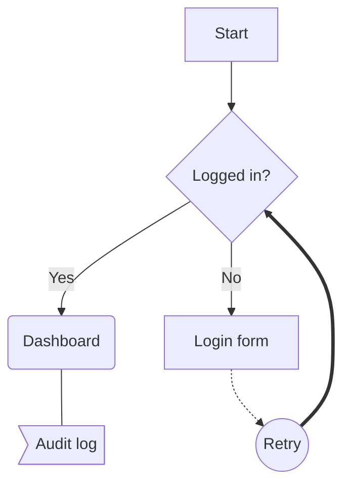
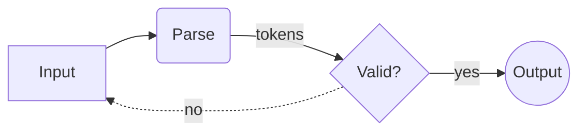
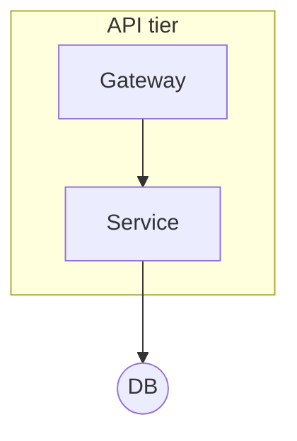
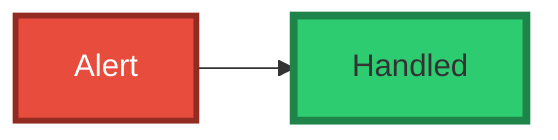
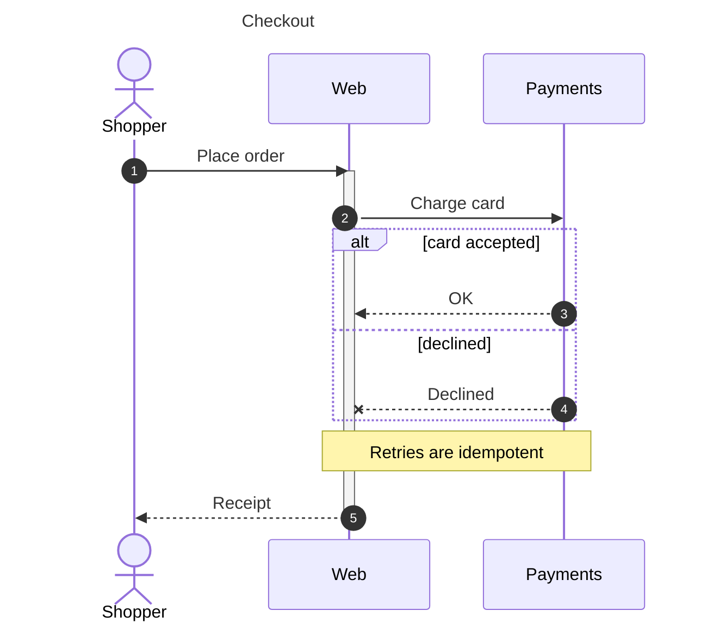
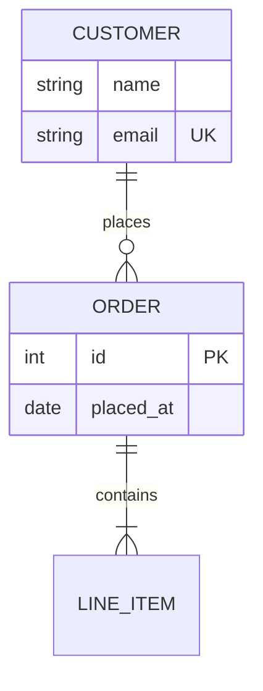
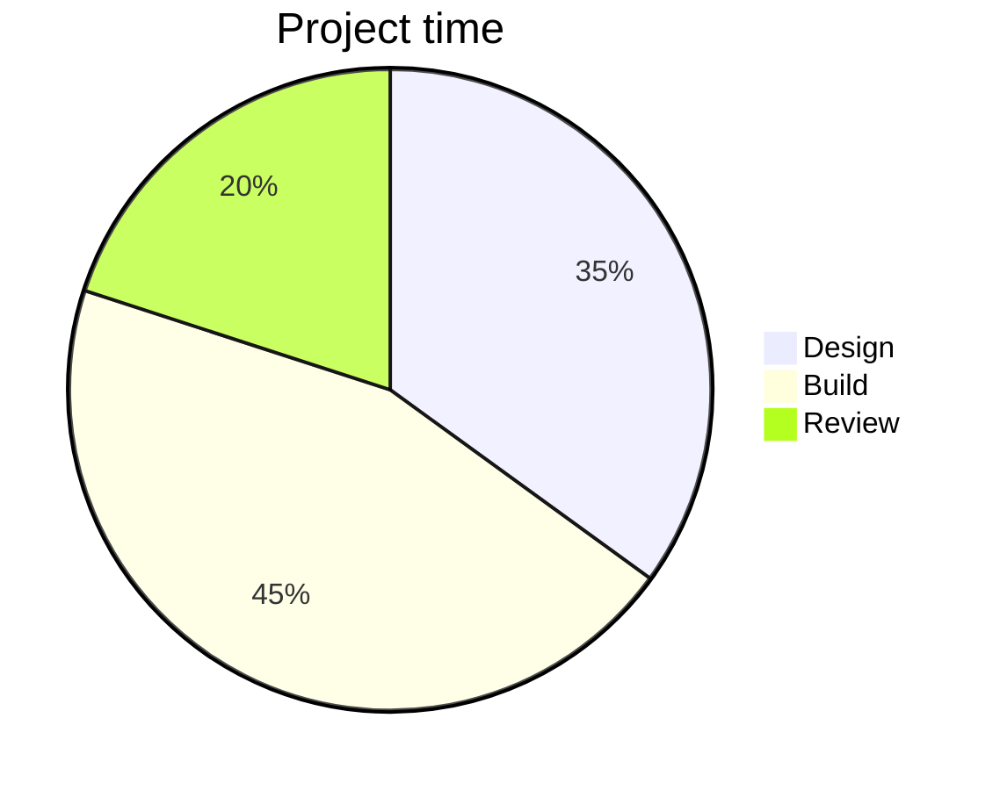
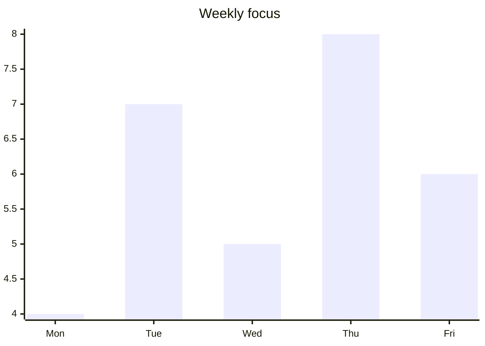
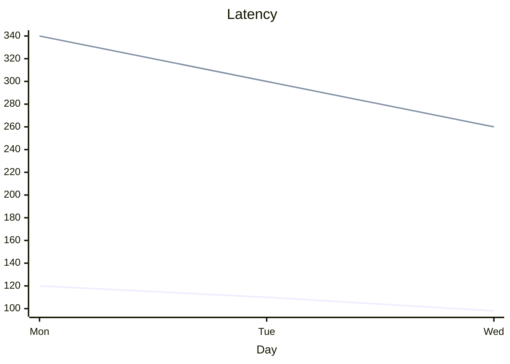

# Mermaid Support

LixSketch turns Mermaid source into ordinary, editable canvas shapes: every node, message, entity and bar becomes its own rectangle, circle, line or arrow inside a frame. Nothing is pasted as a picture, so you can restyle, move and reconnect the result like anything you drew by hand.

LixSketch ships its own parsers and layouts for a subset of Mermaid. This page lists exactly what is supported.

---

## Importing Mermaid

1. Click the violet star in the toolbar to open **DSL Studio**.
2. Choose the **Mermaid** tab.
3. Type or paste Mermaid source, or pick a *Quick example*. A live preview renders on the right as you type.
4. Click **Place on Canvas** or press `Ctrl+Enter`.

The diagram is placed in a new frame centred on the current view, and the first node is selected. One undo step (`Ctrl+Z`) removes the whole diagram.

If the source cannot be parsed the preview shows *Invalid syntax — check your Mermaid code* and nothing is placed.

Mermaid blocks inside the **document editor** (the Docs panel) are rendered by the document editor itself and are not covered by this page.

---

## Supported diagram types

The type is chosen from the first line that is not empty and not a `%%` comment.

| First line | Diagram | Canvas result |
|------------|---------|---------------|
| `graph TD`, `flowchart LR`, … | [Flowchart](#flowcharts) | Rectangles, circles, diamonds, arrows and lines in a frame |
| `sequenceDiagram` | [Sequence diagram](#sequence-diagrams) | Participant boxes, dashed lifelines, message arrows, notes, block frames |
| `erDiagram` | [Entity relationship](#entity-relationship-diagrams) | Entity header + attribute rows, labelled relationship arrows |
| `pie` | [Pie chart](#pie-charts) | Slices drawn as filled strokes, legend |
| `xychart-beta` (or `xychart`) | [Bar / line chart](#xy-charts) | Bars, polylines, axes, legend |
| no recognised header | Flowchart | The whole text is read as flowchart statements, top-down |

### Unsupported diagram types

These are recognised and rejected, so the editor reports *Invalid Mermaid syntax* instead of drawing garbage:

`classDiagram`, `stateDiagram` / `stateDiagram-v2`, `gantt`, `journey`, `gitGraph`, `mindmap`, `timeline`, `quadrantChart`, `requirementDiagram`, `C4Context` and the other C4 types, `sankey-beta`, `block-beta`, `packet-beta`, `architecture-beta`, `kanban`, `radar-beta`, `treemap-beta`, `zenuml`.

---

## Flowcharts

### Header and direction

`graph` or `flowchart` followed by `TD`, `TB`, `LR`, `RL` or `BT`. The header is optional (default `TD`).

| Direction | Layout |
|-----------|--------|
| `TD`, `TB` | Top to bottom |
| `LR` | Left to right |
| `RL` | Laid out left to right (not mirrored) |
| `BT` | Laid out top to bottom (not mirrored) |

Nodes are placed in layers by a breadth-first walk from the nodes without incoming edges; nodes in one layer are centred side by side. Node width grows with the longest label line.

### Nodes

Node ids are letters, digits and `_`. A node is created the first time it is mentioned; a later mention with a shape and label updates it.

| Syntax | Shape | On canvas |
|--------|-------|-----------|
| `A` | rectangle, label = id | Rectangle |
| `A[Label]` | rectangle | Rectangle |
| `A(Label)` | rounded rectangle | Rectangle (rounded in preview) |
| `A((Label))` | circle | Ellipse |
| `A{Label}` | diamond | Square rectangle rotated 45° |
| `A>Label]` | flag | Rectangle (flag in preview) |

Labels may contain ` ` / ` ` for line breaks. Double quotes are stripped.

### Edges

| Syntax | Meaning | On canvas |
|--------|---------|-----------|
| `A --> B` | arrow | Arrow bound to both nodes |
| `A --- B` | line | Line (not bound) |
| `A -.-> B` | dotted arrow | Arrow with dash `5 3` |
| `A ==> B` | thick arrow | Arrow, stroke width 3 |
| `A -- text --> B` | labelled arrow | Edge label |

Any edge type also takes a label between pipes right after the arrow, for example `A -->|yes| B` or `A -.->|retry| B`. A trailing `;` is ignored.

### Subgraphs

`subgraph id`, `subgraph id [Label]` or `subgraph id "Label"`, closed by `end`. Nodes mentioned inside belong to the subgraph. Subgraphs are drawn as dashed boxes in the **preview**; on the canvas their nodes are placed but no box is drawn — group them with a frame afterwards if needed.

### Styling

| Mermaid | LixSketch property | Default when absent |
|---------|-------------------|---------------------|
| `fill` | `fill`, and `fillStyle: solid` | Theme palette (six purple tones, cycled per node) |
| `stroke` | `stroke` | Palette stroke |
| `stroke-width` | `strokeWidth` | `1.5` |
| `color` | `labelColor` | Black or white, whichever contrasts with the fill |

`classDef name …`, `class a,b name` and `style a,b …` are supported; `style` wins over `class`. Other CSS properties (`stroke-dasharray`, `font-size`, …) are ignored. Every node is drawn with `roughness: 1`. Edges use the theme edge colour, stroke width 1.5 (3 for `==>`).

### Not supported in flowcharts

| Feature | What happens |
|---------|--------------|
| Chained edges `A --> B --> C` | Only the first arrow is read; the rest becomes part of the target node's id. Write one edge per line. |
| `&` (`A & B --> C`) | Read as one node named `A & B`. |
| Other node shapes: `([stadium])`, `[[subroutine]]`, `[(database)]`, `{{hexagon}}`, `[/parallelogram/]`, `[\trapezoid/]`, `(((double circle)))`, `@{ shape: … }` | Parsed as the closest bracket form with the inner brackets kept in the label. |
| Edge types `<-->`, `--o`, `--x`, `~~~`, `-.text.->`, `==text==>`, longer arrows `---->` | Not recognised; may produce unexpected nodes. |
| `:::class` shorthand | Not recognised; use `class`. |
| `linkStyle`, `click` | Ignored. |
| `direction` inside a subgraph | Ignored. |
| Markdown strings, Font Awesome icons | Rendered as plain label text. |

---

## Sequence diagrams

| Syntax | Supported | On canvas |
|--------|-----------|-----------|
| `participant A`, `actor A` | yes | Box at the top and bottom, dashed lifeline |
| `participant A as Label` | yes | Messages use `A`, the box shows `Label` |
| Implicit participants | yes | Created in order of first use |
| `title: Text` / `title Text` | yes | Frame title |
| `autonumber` | yes | Message labels prefixed `1.`, `2.`, … |
| `->>` `-->>` | yes | Arrow, solid / dashed (`6 4`) |
| `->` `-->` | yes | Arrow, solid / dashed |
| `-x` `--x` `->>x` `-->>x` | yes | Line without a head (lost message), solid / dashed |
| Self message `A->>A: text` | yes | Three-segment loop ending in an arrow |
| `Note left of A: …`, `Note right of A: …`, `Note over A,B: …` | yes | Note rectangle |
| `alt` / `else`, `opt`, `loop`, `par`, `critical`, `break` | yes | Dashed rectangle labelled `type: condition`, sections for `else` |
| `activate` / `deactivate` | accepted | No activation bar is drawn |

### Not supported in sequence diagrams

| Feature | What happens |
|---------|--------------|
| Activation shorthand `A->>+B`, `B-->>-A` | The `+`/`-` becomes part of the participant name. Use `activate`/`deactivate` lines. |
| `and` inside `par`, `option` inside `critical` | Ignored (no extra section). |
| `rect rgb(…)` highlight blocks, `box` groups | Ignored; their `end` closes the enclosing block early. |
| `create` / `destroy` participant, `links`, `link` | Ignored. |
| Bidirectional arrows `<<->>`, `-)` async | Not recognised; the line is skipped. |

---

## Entity relationship diagrams

| Syntax | On canvas |
|--------|-----------|
| `NAME { type name [key] }` | Header rectangle (palette fill) with one row rectangle per attribute |
| Entity with no attributes | Header plus a *No attributes* row |
| `A <card>--<card> B : label` and `A <card>..<card> B : label` | Arrow from A to B, bound to both headers, labelled `<card> label <card>` |

Cardinality markers are any combination of `|`, `o`, `{`, `}` and are shown verbatim in the label. Entities are laid out in a grid (√n columns).

Not supported: entity aliases `A["Alias"]`, attribute comments `"…"`, quoted entity names. Identifying (`--`) and non-identifying (`..`) relationships are drawn the same way.

---

## Pie charts

`pie`, optionally `showData` and `title …` on the first line or a separate `title …` line, then `"label" : value` rows (quotes optional). Slices are drawn as closed filled strokes with a legend; labels show the percentage.

---

## XY charts

| Syntax | Supported |
|--------|-----------|
| `title "…"` | yes |
| `x-axis [a, b, …]`, `x-axis "Title" [a, b, …]` | yes (categories) |
| `bar [..]`, `bar "Name" [..]` | yes, one or more series |
| `line [..]`, `line "Name" [..]` | yes |
| `y-axis …` | ignored (the range is computed from the data) |
| Numeric x range `x-axis 0 --> 10` | not supported; categories become `1…n` |
| `xychart-beta horizontal` | not supported (drawn vertical) |

When a chart mixes `bar` and `line` series, only the bars are drawn (in preview and on the canvas). A chart with only `line` series is drawn as a line chart.

---

## Limitations

- LixSketch does not run mermaid.js; layouts are its own (layered for flowcharts, column-per-participant for sequences, grid for ER). Large flowcharts may need manual tidying.
- Edges are routed as straight segments between facing sides; there is no crossing minimisation.
- The placed shapes keep no link to the Mermaid source. Edit the shapes directly, or delete the frame and place the diagram again.
- Colours follow the current theme at the moment of placement.

To keep a diagram as editable text, export the canvas as a [`.lixsketch` file](/docs/lixsketch-dsl): every shape created from Mermaid is written out as LixSketch DSL.
